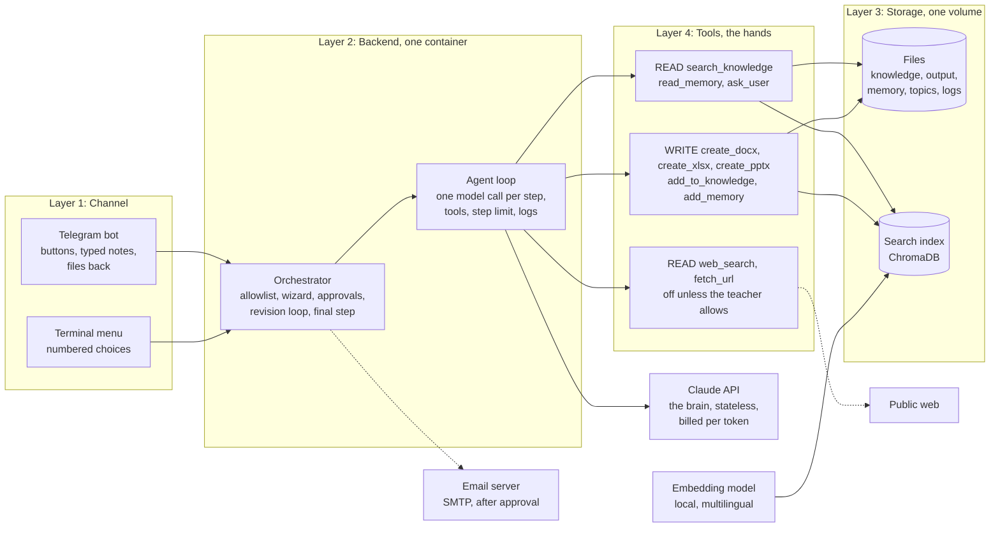
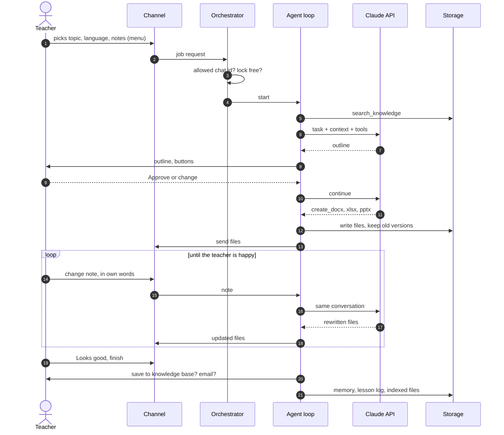

# architecture.md: the decisions, written down

The drawing, plus every choice and its reason. If the system changes, this file changes in the same commit. Requirements live in [spec.md](spec.md); how a ticket is worked lives in [practice.md](practice.md). Today's detailed build notes: [docs/implementation.md](docs/implementation.md). A longer-term design with a database and a dashboard: [docs/target-system-design.md](docs/target-system-design.md) (tickets #23, #24).

---

## Components

Four layers and the external services around them. Each box is a thing that runs; each arrow is data moving.

**Four layers, one rented brain.** Everything on the left and in the middle is hosted by us. The only thing rented per use is the model. Three optional neighbours: Telegram (the channel), an email server and the public web. Unlike a pure chat backend, this one also *thinks a little*: it runs the embedding model locally, which decides its size (see [Hosting](#hosting)).

| Layer | Runs | Does | Code |
|---|---|---|---|
| 1 Channel | Telegram (long polling) or terminal | Shows menus, takes answers and notes, returns files | `agent/channel.py`, `agent/telegram_bot.py`, `agent/menu.py`, `agent/ui.py` |
| 2 Backend | One Python container | Allowlist, wizard, approvals, revision loop, final step, one model call per step, step limit, session log | `agent/__main__.py`, `agent/loop.py`, `agent/llm.py` |
| 3 Storage | A volume at `AGENT_DATA_DIR` | Files, search index, memory, topics, logs | `rag/core.py`, `agent/topics.py` |
| 4 Tools | Inside the backend process | Each is a read or a write (table above) | `agent/tools.py`, `agent/docs.py`, `agent/emailer.py` |

Email sending is **not** a model tool: the orchestrator offers it after the teacher finishes and sends only after a yes.

## Flows

Real-time is decided per flow (spec.md §4). Nothing here streams: the output is files.

| Flow | Mechanism | What happens |
|---|---|---|
| Menu step | Instant | Wizard asks the next question; no model involved |
| Lesson or exam | **Background job** | Request → allowlist → lock → agent: search knowledge, outline, teacher approves, files → files delivered |
| Revision | **Background job**, repeated | Teacher's note → same conversation continues → affected files rewritten (old version kept) → delivered again |
| Finish | Background job | Agent asks whether to save to the knowledge base, writes memory; then the email offer |
| Index files | **Background batch** | Extract, chunk, embed, store; unreadable files reported; model released afterwards |
| Email | Direct, after approval | Attach files up to 20 MB in total, send over SMTP |

## Storage

One volume, plain files, and a search index. No database yet.

| What | Key | Where |
|---|---|---|
| Source file | relative path under `knowledge/`; changed files detected by SHA-1 | `knowledge/` |
| Chunk | `path::location::n` (page, slide or sheet); tagged `teacher` or `generated` | `rag-index/chroma`, with `manifest.json` |
| Generated file | filename inside `output/<date>-<topic>/`; older versions `previous-versions/<name>-vN` | `output/` |
| Memory entry | one of three file names | `memory/` |
| Topic | name, unique ignoring case | `topics.json` |
| Session log | same name as its folder, `logs/<date>-<topic>[-N].json` | `logs/` |

A session folder is `<date>-<topic>`; a second session on the same topic and day becomes `<date>-<topic>-2`, then `-3`, so no session ever overwrites another's files or log (#29).

## Model

| Setting | Value | Why |
|---|---|---|
| Provider | `anthropic` by default; any OpenAI-compatible endpoint is supported | Quality in Arabic and Hebrew; no lock-in |
| Model | `claude-sonnet-5-5` (`config/agent.toml`) | One setting to change |
| Max output | 8,000 tokens per call | Whole documents are written as tool arguments |
| Effort | `high`, set explicitly in `config/agent.toml` | `high` is what `claude-sonnet-5-5` uses anyway; `claude-opus-5-5` would default to `medium`, so a model switch must not change it silently. Lower it only when the evals (#17) show quality holds |
| Fixed context per call | System prompt about 1,800 tokens, 10 tool definitions about 1,100 tokens (measured) | Cacheable (#15) |
| History | Whole conversation resent every call | Needed for revisions; capped later (#14) |
| Embeddings | `multilingual-e5-large`, local, no per-use cost | Arabic, Hebrew, English retrieval; files stay on the machine |

**Every value you can change** (model, limits, timeouts, chunk sizes, eval thresholds) is a setting in `config/agent.toml`, defined once in `agent/settings.py` and documented in [config/README.md](config/README.md). Secrets and paths are not settings: they stay in `.env` (see Secrets).

**Measured per lesson** (3 real sessions, before the revision loop existed): about **10 model calls**, **14 to 18 tool calls**, **78,000 to 107,000 input tokens** (history resent each call), about **6,000 output tokens**. The cost is the model bill, not hosting. Dollar figures need the current price of the chosen model, set in `config/agent.toml` when #11 lands; they are not guessed here.

## Limits

Three layers, three owners. Numbers are in spec.md §6; this is where they live.

| Layer | Owner | Mechanism | Status |
|---|---|---|---|
| Your users → you | Backend | Allowlist; **30 messages per hour per chat id**; 20 MB files | allowlist `[built]`; rate limit #12; uploads #20 |
| You → the model | Backend and the SDK | The SDK retries twice; we add **3 retries with 2 s, 8 s, 30 s** waits, then a friendly "try again in a minute"; a 429 is never shown raw | #13 |
| You → your wallet | Backend | Tokens counted per call (#10); **$3 per day** hard cap; **150,000 input tokens per job** ceiling; "back tomorrow" | #11 |
| Safety valves | Backend | 40 tool steps per turn; one agent job at a time; sessions end after 30 min of silence | `[built]` |

## Hosting

Part 2 of the plan, **design only: nothing is deployed in this phase.** Every box needs a home, a size and a limit.

| Piece | Home | Notes |
|---|---|---|
| Channel and backend | One container from the `Dockerfile` (non-root, tested) | `python -m agent telegram` runs the bot |
| Storage | One volume mounted at `/data` (`AGENT_DATA_DIR`) | Holds files, index and the 2.2 GB embedding model |
| Model | Anthropic API | Rented per use, key from a variable |
| Embeddings | Inside the container (ONNX on CPU) | The reason RAM is the sizing driver |
| Scheduler | None in v1 | A weekly draft (#26) would add a host cron |
| Secrets | Variables on the host | Same names as `.env` |

**Resource sheet (measured where marked, otherwise an estimate):**

| Item | Value |
|---|---|
| Backend idle | about 31 MB for the app code; about 2 GB once the embedding model is loaded for a search (measured peak during indexing: 1.8 GB) |
| CPU | Indexing uses 4 threads by default (half the cores), about 400% for a few minutes; a lesson job waits on the model and uses almost none |
| Disk | Image about 1 GB; embedding model 2.2 GB; knowledge 51 MB today; plan for 10 GB |
| Concurrency | 1 agent job; up to 10 Telegram sessions waiting for their teachers (idle threads) |
| Recommended host | **2 vCPU and 4 GB RAM** minimum |

Sizing rule from the lesson, adjusted: *the service waits, it does not think* is true for the chat part, but **not** for the search part. Local embeddings are why a 512 MB plan will not fit.

| Candidate host | Fits? | Notes (free-tier terms change; verify before relying on them) |
|---|---|---|
| Teacher's own computer | Yes | Works today, only while it is on |
| Always-free ARM VM (for example Oracle Cloud) | Yes | Large RAM, always on, needs a card to sign up |
| Small PaaS plans (about 512 MB: Railway, Render, Fly.io) | No, unless embeddings move to an API | See decision of 2026-10-16 |

## Secrets

Variables, never files, never code. The code reads the same names everywhere and never knows the difference. Locally they live in `.env` (git-ignored); on a host they live in its Variables tab. `.env.example` lists the names with no values.

| Name | Purpose | Secret? |
|---|---|---|
| `ANTHROPIC_API_KEY` | Claude API | **Yes** |
| `OPENAI_API_KEY` | Optional OpenAI-compatible provider | **Yes** |
| `TELEGRAM_BOT_TOKEN` | Telegram bot | **Yes** |
| `TELEGRAM_ALLOWED_IDS` | Chat ids allowed to use the bot | No, but private |
| `SMTP_HOST`, `SMTP_PORT` | Mail server | No |
| `SMTP_USER`, `SMTP_PASSWORD` | Mail login (an app password) | **Yes** (password) |
| `EMAIL_FROM`, `EMAIL_TO` | Sender and default recipients | No, but private |
| `AGENT_DATA_DIR` | Where the volume is mounted | No |
| `AGENT_TERMINAL_BIDI` | Terminal right-to-left handling | No |
| `RAG_THREADS` | CPU threads for embedding | No |

**The test:** grep the repo, and every commit, for `sk-ant`, a bot-token pattern and the SMTP password. It must come back empty. It runs on every change (`tests/test_secrets.py`). If it ever fails: rotate first, then clean history.

## Decisions

Date · choice · reason · what would change it.

| Date | Choice | Reason | Revisit when |
|---|---|---|---|
| 2026-10-16 | Plain files and a local ChromaDB, no database | One teacher; the files are the product; nothing to operate | More than one teacher, or a dashboard needs queries (#23) |
| 2026-10-16 | Local multilingual embeddings, not a hosted embeddings API | Arabic, Hebrew and English retrieval; teacher files never leave the machine; no per-use cost | The host has under 4 GB RAM, or indexing is too slow |
| 2026-10-17 | `fastembed` (ONNX) instead of `sentence-transformers` | No `torch` build for Intel Mac on Python 3.13 | Deploying on ARM or Linux where `torch` works |
| 2026-10-17 | Telegram long polling, not webhooks | No public address or server needed | A stable HTTPS endpoint exists and many users |
| 2026-10-17 | Numbered menus instead of typed input in the terminal | Terminals cannot show or accept right-to-left text | A web UI replaces the terminal |
| 2026-10-17 | Switchable LLM provider | No lock-in; a local model is possible | One provider is proven enough |
| 2026-10-17 | Email is sent by code after approval, never by a model tool | Prompt injection from files or web pages must not be able to send mail | Never, keep the approval gate |
| 2026-10-17 | Web search off by default | Privacy, cost, and the free search is flaky for Arabic and Hebrew | A reliable search provider is added (#18) |
| 2026-10-17 | One agent job at a time (a lock) | The index and model are not safe to share; simple cost control | More than 3 teachers (#22) |
| 2026-10-31 | Tests mock the model; evals call the real model | Tests must be free, fast and identical every run; an agent is only "good enough" | Never |
| 2026-10-31 | Evals use stubbed tools and scripted teacher answers | The environment is fixed, so a score change means the prompt or model changed | Real-tool evals are needed |
| 2026-10-31 | $3 per day and 150,000 input tokens per job | Measured median 78,000 and maximum 107,000 per lesson | A month of real cost data |
| 2026-10-31 | The model can only append one line to memory (`add_memory`); a full rewrite exists only as a human action | A whole-file write lost 2 of 3 notes in a test when the model did not read first, and rewrote the entire log at every finish; code must guarantee what a prompt can only ask | A teacher-facing memory menu needs edits (#37), which use `memory.rewrite` and keep the previous version |
| 2026-10-31 | Preferences and class notes are put into the model's context by code at every session start (newest lines kept, 4,000 characters each) | In 2 of 2 real sessions the model read memory by itself, but nothing required it and no eval checked it; code can guarantee it | The lesson log or the notes grow so large that a summary is needed (#35), or memory moves to a database (#23) |
| 2026-10-31 | Deployment is out of scope for this phase | The course plan covers design, placement, management and tests first | The deployment phase starts |
| 2026-10-31 | `spec.md` and `architecture.md` in lower case at the root; old documents moved to `docs/` | Course convention; case-sensitive Linux CI; the Mac treats `SPEC.md` and `spec.md` as one file | Never |
