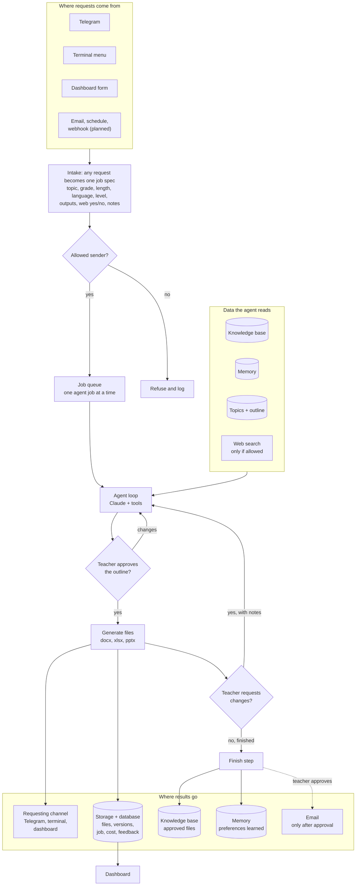
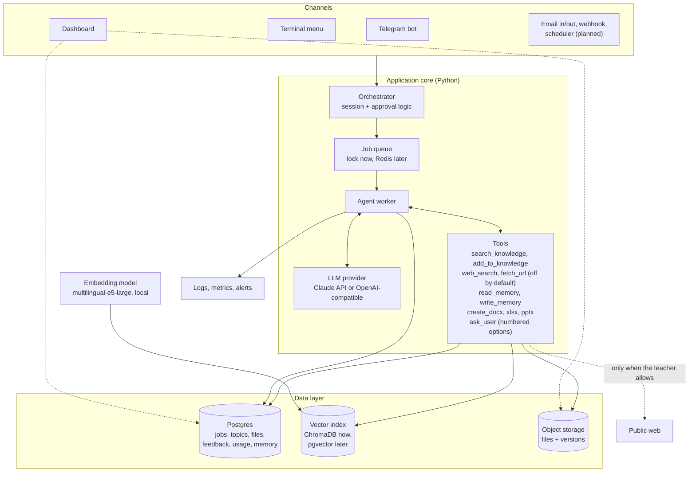
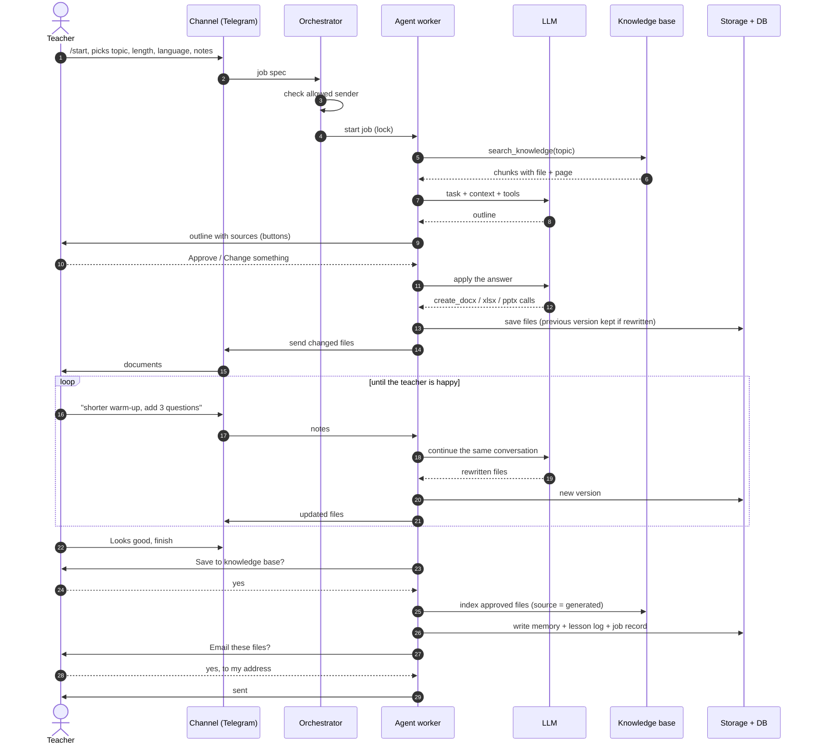
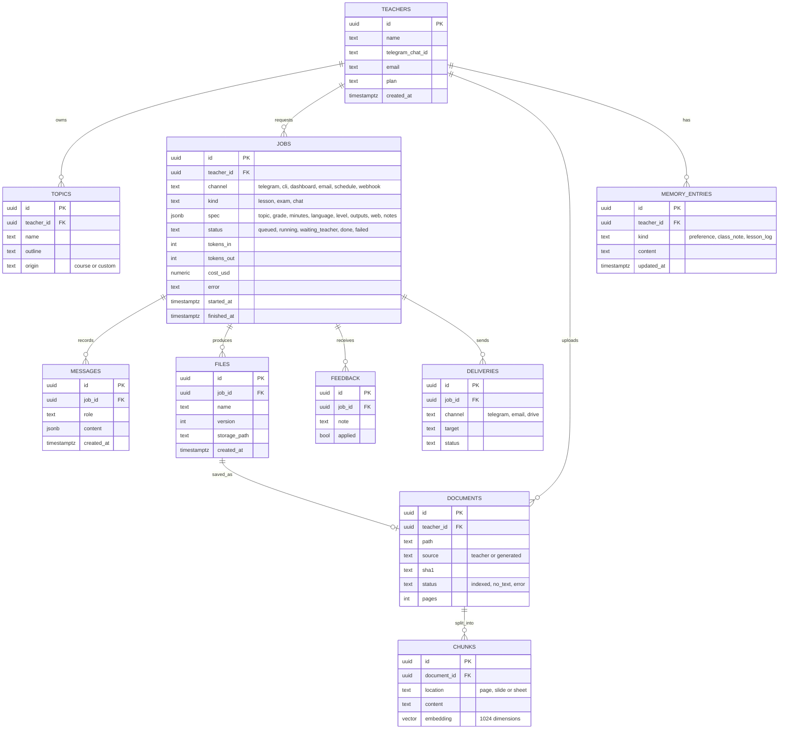
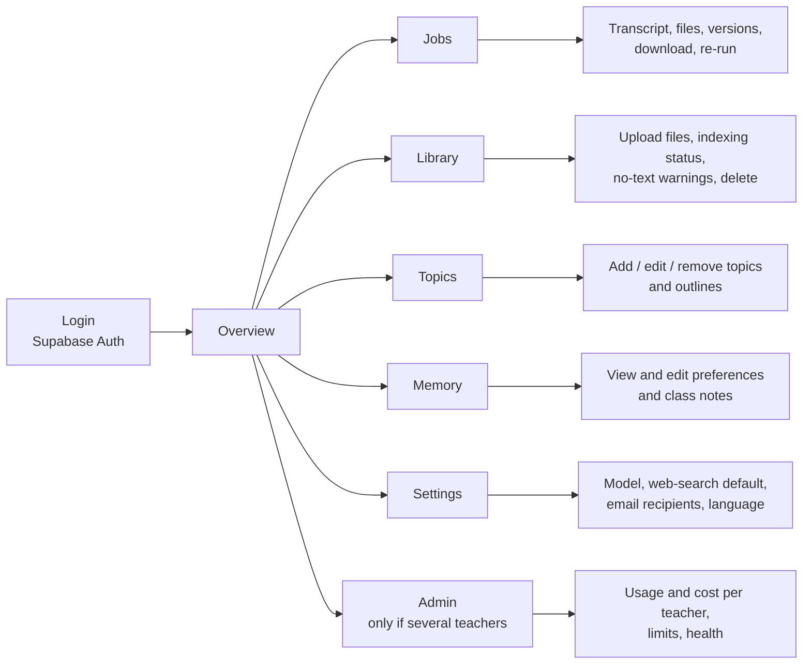
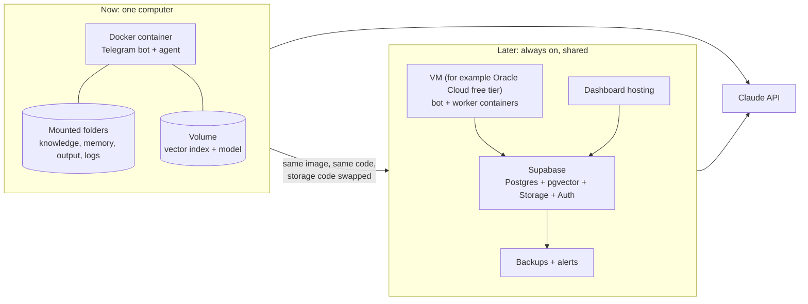

# Target system design: Lesson-Prep Agent

> Longer-term design (database, dashboard, more triggers). The v1 source of truth is [../architecture.md](../architecture.md); this file was `Architecture.md`.

How the system is triggered, how data flows through it, and where every output goes. This document covers the whole system: channels, agent, database, dashboard and deployment.

**Status legend:** ✅ built and in use · 🟡 built but only tested with simulations · 📐 designed, not built yet.

---

## 1. The two questions

### What triggers the agent?

Every trigger produces the same thing: a **job request** (topic, grade, length, language, class level, outputs, web-search yes/no, the teacher's notes). The agent does not care where the request came from.

| # | Trigger | Who or what starts it | Status |
|---|---|---|---|
| T1 | **Telegram message** (`/start`, then buttons or typed text) | The teacher, from a phone | ✅ |
| T2 | **Terminal menu** (`python -m agent`) | The teacher, at the computer | ✅ |
| T3 | **Dashboard "New lesson" form** | The teacher, in a browser | 📐 |
| T4 | **Inbound email** to a dedicated address ("Prepare a lesson on SUMIF, 45 min, Arabic") | The teacher, from any mail app | 📐 |
| T5 | **Schedule** (for example every Sunday: draft next week's lesson from the course pacing) | A cron job, no human | 📐 |
| T6 | **Webhook** from Make or Zapier (a calendar event "Lesson: SQL", a Google Form, a Drive upload) | Another tool | 📐 |
| T7 | **New file in the knowledge folder** (upload through Telegram, the dashboard or Drive) | A file arriving | 📐 (indexing itself is ✅ on demand) |

Triggers T5 and T6 run unattended, so they stop at the **outline approval gate** and wait for a human instead of generating files on their own.

### What happens with the output?

| Output | Where it goes | Status |
|---|---|---|
| Lesson plan, worksheet, quiz, slides (`.docx`, `.xlsx`, `.pptx`) | Back to the **same channel** that asked (Telegram document, terminal path, dashboard download) and saved in `output/` | ✅ |
| The same files, by request | **Email** attachment, only after the teacher approves and picks the recipient | 🟡 |
| Approved final files | **Knowledge base** (`knowledge/generated/`, indexed, searchable later, labeled "generated") | ✅ |
| Preferences and corrections ("shorter warm-ups") | **Memory** files, used in the next session | ✅ |
| Full transcript of every session | `logs/` (JSON) | ✅ |
| Job record, file versions, cost, feedback | **Database** | 📐 |
| Usage, quality and cost numbers | **Dashboard** | 📐 |
| Optional copy of the files | **Google Drive** folder | 📐 |

---

## 2. End-to-end data flow



Human checkpoints (the agent never skips these): **outline approval**, **change requests**, **saving to the knowledge base**, **sending email**.

---

## 3. System architecture



### Components

| Component | Responsibility | Current implementation | Status |
|---|---|---|---|
| Channels | Receive requests, show menus, deliver files | `agent/channel.py` interface; terminal and `agent/telegram_bot.py` | ✅ |
| Orchestrator | One session per teacher: wizard, approvals, revision loop, final step | `run_session` and `main_menu` in `agent/__main__.py` | ✅ |
| Job queue | Make sure heavy jobs do not collide | One global lock | ✅ (basic) |
| Agent loop | Call the LLM, run tools, repeat; continue an earlier conversation | `agent/loop.py` | ✅ |
| LLM provider | Switchable model | `agent/llm.py`, `config/agent.toml` | ✅ |
| Tools | RAG, web, memory, file creation, questions | `agent/tools.py`, `agent/docs.py` | ✅ |
| RAG | Extract, chunk, embed, search, source tags | `rag/core.py` (ChromaDB, fastembed) | ✅ |
| Memory | Preferences, class notes, lesson log | markdown files in `memory/` | ✅ |
| Topics | Course units + the teacher's own topics | `agent/topics.py`, `topics.json` | ✅ |
| Email out | Send files after approval | `agent/emailer.py` | 🟡 |
| Database | Jobs, files, feedback, usage, teachers | none yet (files and logs) | 📐 |
| Object storage | Files and versions | local `output/` | 📐 (cloud) |
| Dashboard | Monitor, review, manage | none yet | 📐 |
| Inbound email, webhook, scheduler | More triggers | none yet | 📐 |
| Container | Run anywhere | `Dockerfile`, volume at `/data` | ✅ |

---

## 4. One lesson, step by step



---

## 5. Database design

Supabase (Postgres with pgvector, Storage and Auth) is the planned home. Everything is scoped by `teacher_id` with row-level security, so one teacher can never read another's data. The local build keeps the same data in files and ChromaDB, so the move changes storage code only (`rag/core.py`, the memory and topic helpers).



| Table | Replaces today's | Why it matters |
|---|---|---|
| `jobs`, `messages` | `logs/*.json` | Searchable history, cost per lesson, failure reasons |
| `files` (with `version`) | `output/` and `previous-versions/` | Compare versions, re-download, delete on request |
| `documents`, `chunks` | `knowledge/` + ChromaDB + `manifest.json` | Shows which files are searchable, and which are scanned images with no text |
| `memory_entries` | `memory/*.md` | Editable from the dashboard |
| `topics` | `topics.json` + `config/course-outline.md` | Per-teacher topic lists |
| `feedback` | notes inside the conversation | Measure how often a first draft needs changes |

**Privacy rules for the database:** no student names or personal data are stored; transcripts are kept for a limited time that the teacher can change; deleting a teacher deletes their files, chunks and memory.

---

## 6. Dashboard design

A small web app (Next.js or Streamlit) on top of Supabase Auth. It reads the database; it never talks to the model directly, so it cannot spend credit by itself except through the "New lesson" form, which creates a normal job.



| Page | Shows | Why |
|---|---|---|
| Overview | Jobs per day, success rate, median time to finish, cost this month, jobs waiting for the teacher | Is the agent healthy and affordable? |
| Jobs | Every request with its transcript, files and versions, cost, and the teacher's change requests | Find out why a lesson went wrong, and re-download files |
| Library | Every knowledge file with its status: indexed, **no readable text**, error; upload new files | Stops scanned PDFs from looking searchable |
| Topics | Course units and the teacher's own topics, with outlines | Same as the menu, in a browser |
| Memory | The preferences and class notes the agent has learned | Correct or delete anything wrong |
| Settings | LLM choice, default web-search setting, allowed email recipients, default language | One place for configuration |
| Admin | Per-teacher usage, cost limits, errors | Needed only if the product is sold |

**Metrics worth tracking:** share of lessons that need at least one change request (quality), average revisions per lesson, cost per lesson, time from request to first file, share of searches that returned nothing relevant (knowledge gaps), and share of web searches that failed.

---

## 7. Security and privacy

| Risk | Control |
|---|---|
| Strangers using the bot and spending credit | Allowlist of chat ids; others get a refusal that shows only their own id (✅) |
| Prompt injection from a knowledge file or web page | Tool results are marked as data, not instructions; the model has no email or posting tool; the only outputs are files in the job folder (✅) |
| Email sent to the wrong person | Sending is done by code, not by the model, only after a yes and a chosen recipient (🟡) |
| Web access leaking or fetching internal addresses | Web tools off by default; `fetch_url` refuses private and local addresses (✅) |
| Secrets in code or images | Keys only in `.env` or the host's secret store; `.dockerignore` and `.gitignore` keep them, logs, topics and knowledge files out of the image and the repository (✅) |
| One teacher seeing another's data | Row-level security on every table, per-teacher storage folders (📐) |
| Student personal data | Never requested or stored; only generic teaching material is produced (✅ by design) |
| Runaway cost | Step limit per turn (✅); daily and monthly limits per teacher, with an alert (📐) |
| Container compromise | Runs as a non-root user with one data volume (✅) |

---

## 8. Deployment



- **Now:** the image is built and tested on Docker Desktop (menu, persistence across containers, indexing and Arabic/English search inside the container). The Telegram bot runs with `docker run ... telegram` while the computer is on.
- **Later:** an always-on host keeps the bot running; the database, storage and dashboard move to Supabase. The code only needs a storage layer behind `rag/core.py`, the memory and topic helpers, and the file output folder.

---

## 9. Reliability and cost

| Failure | What the system does |
|---|---|
| LLM call fails or rate-limits | The error is shown to the teacher and logged; the conversation is kept so "continue" resumes it (📐 automatic retry with backoff) |
| Tool error | Returned to the model as an error result so it can recover; shown as status only |
| Free web search fails | The model is told to continue without web results; worst-case wait about 30 seconds (✅) |
| File has no readable text | Reported in a WARNING after every index run until fixed (✅) |
| Teacher stops answering | The Telegram session ends after 30 minutes; the job record stays (✅) |
| Two teachers ask at once | One agent job at a time, the other is told to wait; the lock is held only while the agent works (✅) |
| Container restarts | Volume keeps knowledge, memory and the index; running conversations are lost (📐 persist job state in the database) |

**Cost control:** the biggest cost is the LLM, and long conversations cost more because the whole history is sent each turn. Planned: record tokens and cost per job, show them on the dashboard, enforce a monthly cap per teacher, and summarise old turns in very long sessions.

---

## 10. Roadmap

| Phase | Adds | Done when |
|---|---|---|
| 1 ✅ | Terminal menu, agent, RAG, memory, files, Docker | A lesson with changes is produced from the teacher's own material |
| 2 ✅ | Telegram, email out, web-search choice, custom topics, revision loop | The teacher runs lessons from the phone |
| 3 📐 | Supabase: jobs, files, feedback, usage; cost tracking | Every job is a database row with its cost |
| 4 📐 | Dashboard: overview, jobs, library, topics, memory | The teacher can review work and fix knowledge gaps in a browser |
| 5 📐 | More triggers: inbound email, schedule, Make/Zapier webhook, file upload through Telegram | A weekly draft appears without being asked, waiting for approval |
| 6 📐 | Several teachers: accounts, row-level security, limits, billing | A second teacher can use it with separate data |

---

## 11. Where it lives in the code

```
agent/
  __main__.py     orchestrator: menus, sessions, revision loop, email offer
  channel.py      channel interface + terminal channel
  telegram_bot.py Telegram client, channel, bot (allowlist, one session per chat)
  loop.py         agent loop (continuable conversation)
  llm.py          Claude / OpenAI-compatible providers
  tools.py        tool definitions and runner
  docs.py         Word / Excel / PowerPoint generation with RTL
  menu.py         wizards and numbered menus
  topics.py       course units + own topics
  emailer.py      send files by email (SMTP)
rag/core.py       extract, chunk, embed, index, search
rag/server.py     MCP wrapper for Claude Code
config/           agent.toml, system-prompt.md, teacher profile, course outline
Dockerfile        container image
docs/implementation.md   detailed notes on what is built
```
